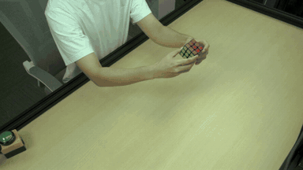
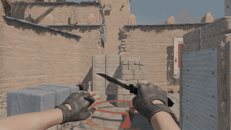
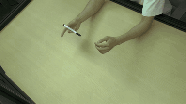

<!-- =====================================================================
     TODO BEFORE PUBLIC RELEASE:
       Replace XXXX.XXXXX with your live arXiv paper ID (e.g. 2611.12345).
     ===================================================================== -->

<div align="center">

# HandQuery: Dense Vertex Queries for Multi-View 4D Hand Reconstruction

**Yi Gu**<sup>&dagger;1</sup>, **Xuanhua Chen**<sup>&dagger;1</sup>, **Yupei Zeng**<sup>1</sup>, **Hanyang Cao**<sup>1</sup>, **Mingxi Xu**<sup>1</sup>, **Yukang Gao**<sup>1</sup>, **Yangchen Zhou**<sup>1</sup>,<br>
**Fanghai Zhang**<sup>1</sup>, **Weiming Zhang**<sup>1</sup>, **Jiaxu Wang**<sup>1</sup>, **Kang Du**<sup>1</sup>, **Zhengyang Shen**<sup>2</sup>, **Renjing Xu**<sup>1</sup>

<sup>1</sup>HKUST(GZ) &nbsp;&nbsp;&nbsp;&nbsp; <sup>2</sup>Google &nbsp;&nbsp;&nbsp;&nbsp; <sup>&dagger;</sup>Equal Contributions

<p>
  <a href="https://reconworldlab.github.io/handquery/"></a>
  <a href="https://arxiv.org/abs/XXXX.XXXXX"></a>
  <a href="https://drive.google.com/file/d/1Bv7Tz0IYnniWy5PRP7HpRc1StZNCBQtm/view?usp=sharing"></a>
  <a href="LICENSE"></a>
</p>

Official PyTorch implementation of **HandQuery**, achieving state-of-the-art performance in multi-view hand pose estimation and 4D mesh reconstruction.

<table>
  <tr>
    <th width="33.3%" align="center">Rubik's Cube</th>
    <th width="33.3%" align="center">Counter-Strike 2</th>
    <th width="33.3%" align="center">Pen Spinning</th>
  </tr>
  <tr>
    <td align="center"></td>
    <td align="center"></td>
    <td align="center"></td>
  </tr>
</table>

</div>

---

## Installation

```bash
git clone https://github.com/ReconWorldLab/handquery.git
cd handquery

pip install -r requirements.txt
pip install -e .
```

> **Note:** Install a CUDA-enabled build of `torch >= 2.1` matching your system from [pytorch.org](https://pytorch.org/get-started/locally/) before running `pip install -e .`.

---

## Checkpoints & MANO Assets

### 1. Pretrained Checkpoint
Download `handquery_vitb.pt` from **[Google Drive](https://drive.google.com/file/d/1Bv7Tz0IYnniWy5PRP7HpRc1StZNCBQtm/view?usp=sharing)** and place it at:

```text
checkpoints/handquery_vitb.pt
```

| Model | Backbone | Window `T` | Slots / Hand | Download | DexYCB-MV MPVPE | HO3D-MV MPVPE | OakInk-MV MPVPE | ARCTIC-MV MPVPE | InterHand-MV MPVPE |
| :--- | :---: | :---: | :---: | :---: | :---: | :---: | :---: | :---: | :---: |
| `handquery_vitb.pt` | ViT-B/16 + PRoPE | 48 | 778 | [Google Drive](https://drive.google.com/file/d/1Bv7Tz0IYnniWy5PRP7HpRc1StZNCBQtm/view?usp=sharing) | **4.38 mm** | **5.63 mm** | **5.26 mm** | **4.48 mm** | **3.68 mm** |

### 2. MANO Hand Model (Required for 3D Mesh Fitting)
Download `MANO_RIGHT.pkl` and `MANO_LEFT.pkl` from the [official MANO website](https://mano.is.tue.mpg.de/) and place them under `assets/mano/`:

```text
assets/
└── mano/
    ├── MANO_RIGHT.pkl
    └── MANO_LEFT.pkl
```

*(Note: 2D dense 778-vertex tracking, uncertainty estimation, and visibility prediction with `--no-fit` do **not** require external MANO `.pkl` files.)*

---

## Built-In Demo Sequences & Interactive 3D Viewer (`viser`)

Two calibrated 4-view real-world bimanual manipulation sequences — **Rubik's Cube** (`examples/rubik_cube`, with articulated 26-cubie 3D mesh & tracked layer turns) and **Pen Spinning** (`examples/pen_spinning`, with 3D marker mesh & tracked 6-DoF motion) — are included directly in `examples/`.

### 1. Run 4D Reconstruction on the Built-In Examples

```bash
python scripts/infer.py \
    --input examples/rubik_cube/scene.json \
    --ckpt checkpoints/handquery_vitb.pt \
    --mano-root assets \
    --out outputs/rubik_cube

python scripts/infer.py \
    --input examples/pen_spinning/scene.json \
    --ckpt checkpoints/handquery_vitb.pt \
    --mano-root assets \
    --out outputs/pen_spinning
```

### 2. Launch the Interactive 3D + Multi-View Camera Viewer (`viser`)

```bash
python scripts/view_viser.py \
    --scenes examples/rubik_cube/scene.json:outputs/rubik_cube \
             examples/pen_spinning/scene.json:outputs/pen_spinning \
    --port 8080
```

Open **`http://localhost:8080`** in your browser to inspect:
- Reconstructed 3D left & right MANO hand meshes and optional 21-joint skeletons,
- Animated 3D Rubik's Cube (with turning layers) and spinning pen meshes,
- Calibrated 3D camera frustums textured with synchronized original camera frames (click any frustum to snap to its camera view), plus a live 2×2 multi-view camera panel with optional 2D mesh projection overlay.

---

## Multi-View Benchmark Evaluation & External Datasets

Out-of-the-box preparation, quantitative evaluation, and zero-shot inference are supported for **all 7 external multi-view hand datasets** (`DexYCB`, `HO3D v3`, `OakInk v2`, `ARCTIC`, `InterHand-MV`, `SHOW3D`, and `GigaHands`) directly from their downloaded raw directories — with **no `pyrender` or `EGL` required**.

See **[docs/DATASETS.md](docs/DATASETS.md)** for official download links, minimal evaluation-only archives, and expected folder layouts.

```bash
# 1. Prepare any combination of downloaded benchmark directories:
python scripts/prepare_datasets.py \
    --dexycb /path/to/DexYCB \
    --ho3d /path/to/HO3D_v3 \
    --oakink /path/to/OakInk \
    --arctic /path/to/ARCTIC \
    --interhand-mv /path/to/POEM_Interhand_mv \
    --mano-root assets \
    --out data/benchmarks

# 2. Evaluate across GPUs and reproduce the Table 1 metrics:
python scripts/evaluate.py \
    --data-root data/benchmarks \
    --ckpt checkpoints/handquery_vitb.pt \
    --mano-root assets \
    --gpus 0 1 2 3 \
    --out outputs/eval
```

| Benchmark | Views | Scored Frames | MPVPE ↓ | RR-V ↓ | PA-V ↓ | AUC-V ↑ | MPJPE\* ↓ | RR-J\* ↓ | PA-J\* ↓ |
| :--- | :---: | :---: | :---: | :---: | :---: | :---: | :---: | :---: | :---: |
| **DexYCB-MV** | 8 | 4,951 | **4.38** | 5.09 | **2.77** | 0.784 | 4.26 | 5.12 | 2.72 |
| **HO3D-MV** | 5 | 2,706 | **5.63** | 6.81 | **3.45** | 0.887 | 5.30 | 6.52 | 2.96 |
| **OakInk-MV** | 4 | 4,978 | **5.26** | 5.86 | **3.37** | 0.737 | 4.97 | 5.67 | 3.00 |
| **ARCTIC-MV** | 8 | 17,393 | **4.48** | 6.38 | **3.41** | 0.776 | 3.94 | 6.09 | 2.89 |
| **InterHand-MV** | 8 (×17) | 85,255 | **3.68** | 4.46 | **2.59** | 0.817 | 3.29 | 4.43 | 2.09 |

---

## Custom Sequence Inference

### 1. Command-Line Interface

Prepare a JSON manifest (`scene.json`) describing your calibrated cameras, synchronized videos (or frame paths), and 2D hand bounding boxes (`[x0, y0, x1, y1]` in pixels, `NaN` when undetected):

```json
{
  "fps": 30.0,
  "K": "K.npy",
  "R": "R.npy",
  "t": "t.npy",
  "videos": ["videos/cam00.mp4", "videos/cam01.mp4", "videos/cam02.mp4", "videos/cam03.mp4"],
  "hands": {
    "right": "boxes_right.npy",
    "left": "boxes_left.npy"
  }
}
```

Camera convention:
- `K`: `(C, 3, 3)` pinhole intrinsics in pixels (`fx, fy, cx, cy`).
- `R`: `(C, 3, 3)` and `t`: `(C, 3)` world-to-camera extrinsics in **meters** (`X_cam = R @ X_world + t`).
- `boxes_*`: `(C, T, 4)` float array `[x0, y0, x1, y1]` in source image pixels (`NaN` where the hand is absent).

```bash
python scripts/infer.py \
    --input path/to/scene.json \
    --ckpt checkpoints/handquery_vitb.pt \
    --mano-root assets \
    --out outputs/demo \
    --render \
    --export-obj
```

Outputs saved to `outputs/demo/`:
- `{side_}pred2d.npz`: fused 2D vertex coordinates `lm (C, T, 778, 2)`, pixel uncertainty `sigma (C, T, 778)`, visibility `vis (C, T, 778)`, and `valid (C, T)`.
- `{side_}mano_fit.npz`: metric 3D world-space `verts (T, 778, 3)`, `joints21 (T, 21, 3)`, `faces (1538, 3)`, shared `betas (1, 10)`, `global_orient (T, 3)`, `pca (T, 45)`, `hand_pose (T, 45)`, and `transl (T, 3)`.
- `overlay.mp4` *(with `--render`)*: multi-view mesh overlay video.
- `{side_}meshes/frame_XXXXXX.obj` *(with `--export-obj`)*: per-frame Wavefront OBJ meshes.

### 2. Python API

```python
from handquery import HandQueryPipeline

pipe = HandQueryPipeline.from_pretrained(
    ckpt_path="checkpoints/handquery_vitb.pt",
    mano_root="assets",
    device="cuda",
)

result = pipe.reconstruct(
    ["cam0.mp4", "cam1.mp4", "cam2.mp4", "cam3.mp4"],
    K=K,                    # (C, 3, 3) pixels
    R=R,                    # (C, 3, 3) world -> cam
    t=t,                    # (C, 3) world -> cam (meters)
    boxes=boxes_right,      # (C, T, 4) [x0, y0, x1, y1], NaN if undetected
    side="right",
    fit_mano=True,
)

verts_world = result["verts"]       # (T, 778, 3) meters
joints_world = result["joints21"]   # (T, 21, 3) meters
```

---

## Repository Structure

```text
handquery/
├── checkpoints/            # Place handquery_vitb.pt here
├── assets/                 # Place mano/MANO_{RIGHT,LEFT}.pkl here; built-in eval subsets/
├── docs/
│   ├── assets/             # README demo animations
│   └── DATASETS.md         # Download, preparation & evaluation guide for all 7 datasets
├── examples/               # Built-in 4-view demo sequences (rubik_cube & pen_spinning)
├── handquery/
│   ├── datasets.py         # Zero-OpenGL converters for DexYCB, HO3D, OakInk, ARCTIC, InterHand-MV, SHOW3D, GigaHands
│   ├── geometry.py         # Pinhole projection, virtual-camera crops, Jacobian inverse homography
│   ├── mano.py             # Chumpy-free MANO loader, 45-DoF PCA layer, 21-joint definitions
│   ├── metrics.py          # Standard 3D vertex/joint metrics (MPVPE, RR-V, PA-V, AUC-V, POEM J*)
│   ├── fit.py              # Threaded DLT + Procrustes + CUDA-graphed 3-stage MANO fitter
│   ├── inference.py        # Sliding-window multi-view inference & 1/sigma^2 fusion pipeline
│   ├── ply.py              # Dependency-free PLY triangle mesh & vertex-color loader
│   ├── vis.py              # Multi-view mesh/landmark video renderer & OBJ exporter
│   ├── viser_viewer.py     # Interactive 3D + multi-view camera viewer (viser)
│   └── model/
│       ├── layers.py       # PatchEmbed, Attention, CrossBlock, MLP
│       ├── prope.py        # Projective Positional Encoding (PRoPE) cross-view attention
│       ├── time_encoding.py# Sinusoidal temporal positional encodings
│       ├── encoder.py      # Spatiotemporal ViT-B/16 multi-view video encoder
│       └── network.py      # HandQueryNet dense vertex query decoder
└── scripts/
    ├── infer.py            # CLI entry point for 4D hand reconstruction
    ├── prepare_datasets.py # CLI entry point for raw dataset preparation
    ├── evaluate.py         # CLI entry point for multi-GPU benchmark evaluation
    └── view_viser.py       # CLI entry point for the interactive viser 3D viewer
```

---

## Citation

If you find **HandQuery** useful for your research, please consider citing:

```bibtex
@article{gu2026handquery,
  title   = {HandQuery: Dense Vertex Queries for Multi-View 4D Hand Reconstruction},
  author  = {Gu, Yi and Chen, Xuanhua and Zeng, Yupei and Cao, Hanyang and Xu, Mingxi and Gao, Yukang and Zhou, Yangchen and Zhang, Fanghai and Zhang, Weiming and Wang, Jiaxu and Du, Kang and Shen, Zhengyang and Xu, Renjing},
  journal = {arXiv preprint arXiv:XXXX.XXXXX},
  year    = {2026}
}
```

---

## Acknowledgements & License

This codebase is released under the [Apache-2.0 License](LICENSE).
- Multi-view relative camera encoding builds upon [PRoPE](https://github.com/liruilong940607/prope) (MIT License).
- 3D hand mesh parameterization uses [MANO](https://mano.is.tue.mpg.de/) via [`smplx`](https://github.com/vchoutas/smplx); MANO model files are subject to their original license terms.
